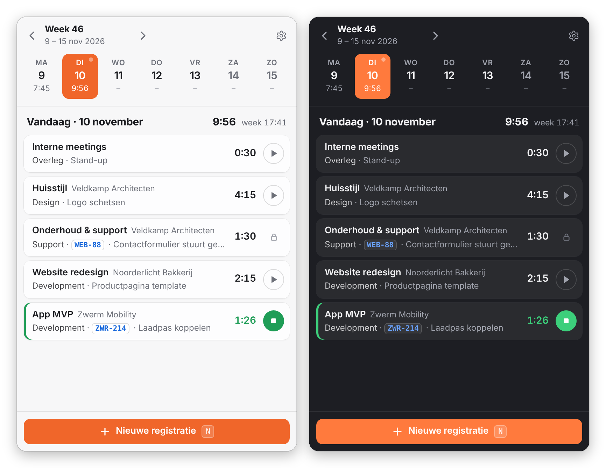
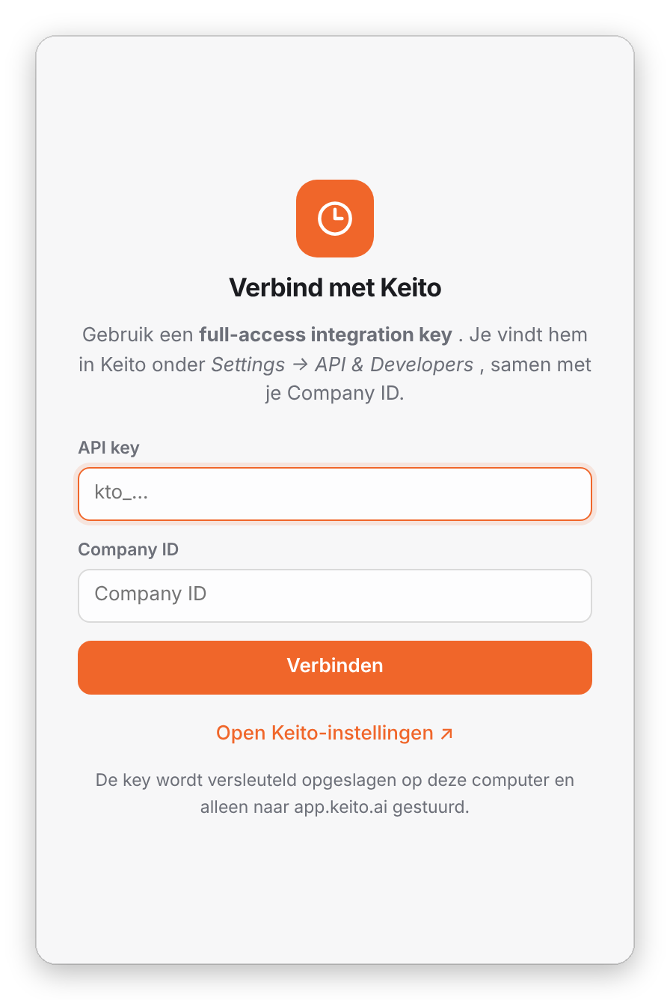
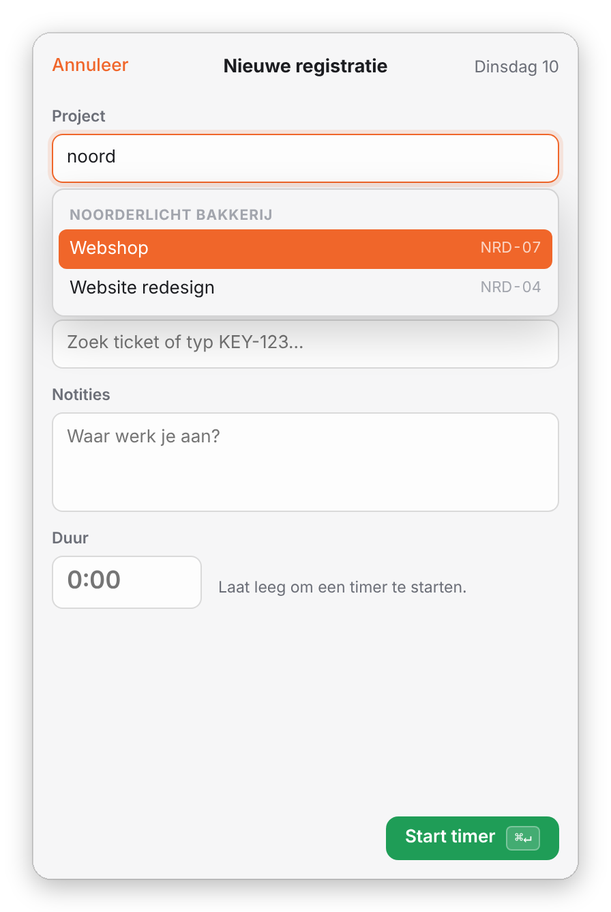
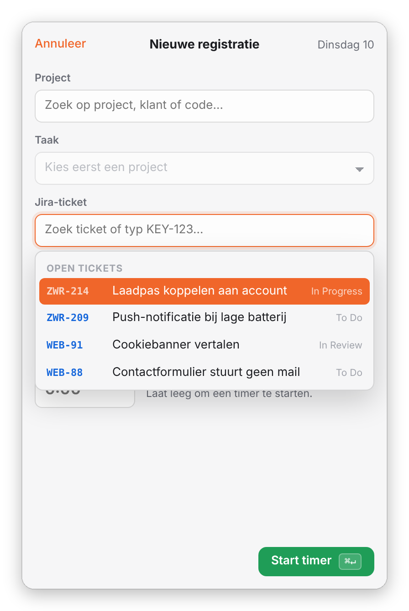
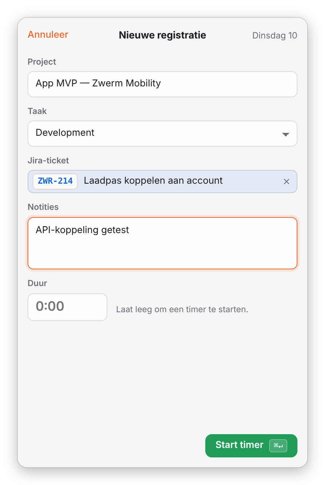
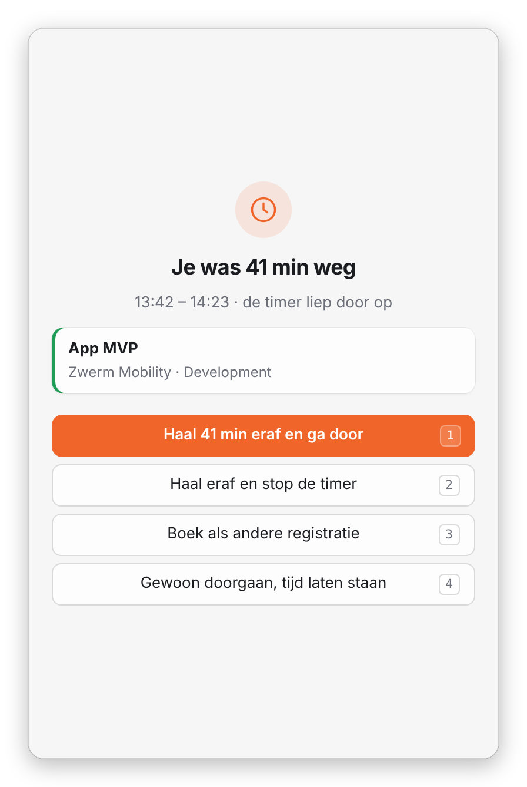
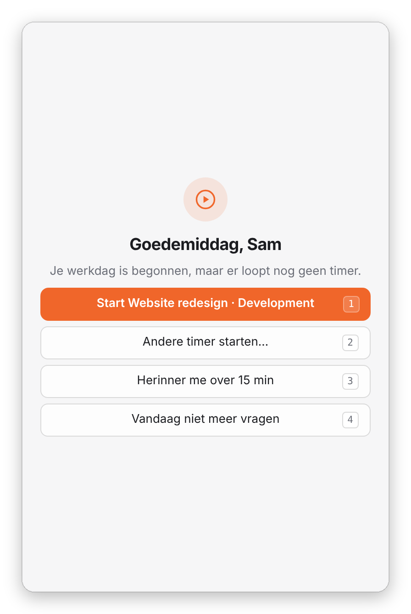
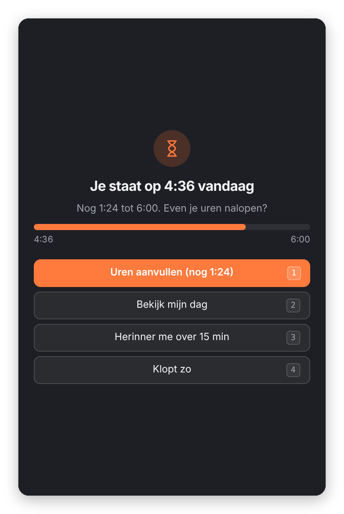
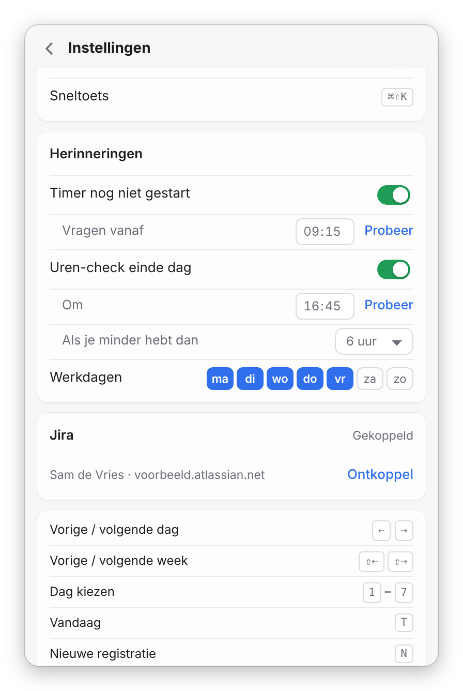
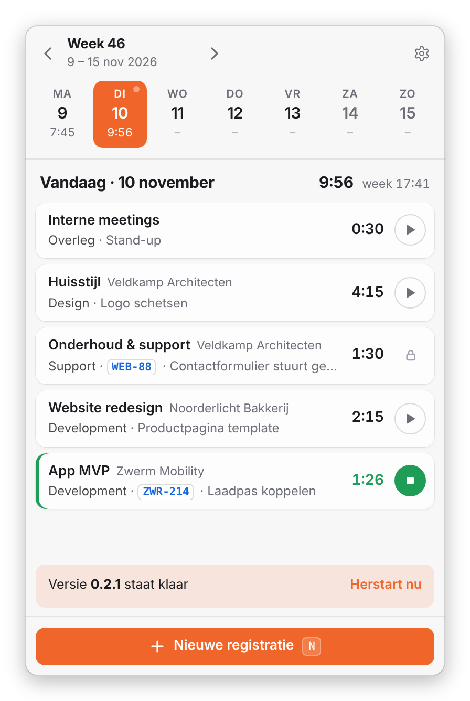

# Keito Bar

Tijd schrijven in Keito vanuit je menubalk. Bovenin zie je je week en je klikt (of pijltje
links/rechts) zo door de dagen, net als in Harvest. Zonder "recente projecten"-ruis, mét
Jira-tickets, idle-detectie en een seintje als je vergeet je timer aan te zetten.

<p align="center">
  
</p>

**[⬇︎ Download de nieuwste versie](https://github.com/jimvaneijk/keito-bar/releases/latest)**
· macOS 12 of nieuwer · Apple Silicon

---

## Installeren

### 1. Downloaden en installeren

1. Download **`Keito-Bar-x.y.z-arm64.dmg`** via de link hierboven (onder *Assets*).
2. Open de DMG en sleep **Keito Bar** naar **Programma's**.
3. Open Keito Bar vanuit Programma's. Er verschijnt een klokje rechtsboven in je menubalk;
   de app heeft geen Dock-icoon.

> **Had je al een oudere versie (van vóór 0.2.0)?** Stop die eerst: klik met rechts op het
> klokje → *Stoppen*. Sleep daarna de nieuwe versie naar Programma's en kies *Vervang*.
> Dit hoeft maar één keer; vanaf nu werkt de app zichzelf automatisch bij.

### 2. Verbinden met Keito

Bij de eerste start opent het venster vanzelf.



1. Ga in Keito naar **Settings → API & Developers**.
2. Maak een **full-access integration key** aan (begint met `kto_`).
   Een *personal read-only sync key* werkt niet: daarmee kun je geen uren schrijven.
3. Kopieer de key en je **Company ID** naar Keito Bar en klik op **Verbinden**.

De key wordt versleuteld opgeslagen in je macOS-sleutelhanger en alleen naar
`app.keito.ai` gestuurd.

<br clear="right">

### 3. Jira koppelen (optioneel)

Wil je tickets aan je uren koppelen? Ga naar **Instellingen** (tandwiel rechtsboven) → **Jira**:

1. Vul je Jira-adres in, bijvoorbeeld `jouwbedrijf.atlassian.net`.
2. Vul het e-mailadres van je Atlassian-account in.
3. Maak een API-token aan via **API token aanmaken ↗** en plak het erin.

### 4. Laatste puntjes

In **Instellingen** kun je nog:

- **Openen bij inloggen** aanzetten, zodat Keito Bar altijd klaarstaat
- je **accentkleur** kiezen
- je **werkdagen** en **herinneringstijden** instellen (zie [Herinneringen](#herinneringen))

---

## Gebruiken

Klik op het klokje in de menubalk, of druk overal op **⌘⇧K**.

### Uren schrijven

<table>
  <tr>
    <td width="33%"></td>
    <td width="33%"></td>
    <td width="33%"></td>
  </tr>
  <tr>
    <td>Zoek op project, klant of code. Alles staat gegroepeerd per klant.</td>
    <td>Kies een Jira-ticket (<kbd>⌘J</kbd>). Leeg zoeken toont je open tickets.</td>
    <td>Duur leeg laten = timer starten. Anders <code>1:30</code>, <code>1,5</code>, <code>90m</code> of <code>1h30</code>.</td>
  </tr>
</table>

- **Timer starten/stoppen**: de knop naast een registratie. Een nieuwe timer stopt de vorige.
- **Andere dag**: klik een dag in de weekstrip, of <kbd>←</kbd> <kbd>→</kbd>. Op andere dagen voeg je uren toe met een duur.
- **Bewerken of verwijderen**: klik op een registratie. Goedgekeurde uren (🔒) zijn alleen-lezen.
- **Taak**: de app onthoudt per project welke taak je het laatst gebruikte.
- **Jira**: de notitie wordt opgeslagen als `KEY-123 · samenvatting — jouw notitie`. Ticketnummers in je lijst zijn klikbaar.

### Idle-tijd



Loopt je timer terwijl je weg bent (geen muis/toetsenbord, scherm op slot of laptop dicht),
dan vraagt Keito Bar bij terugkomst wat je met die tijd wilt:

1. **Haal eraf en ga door**
2. **Haal eraf en stop de timer**
3. **Boek als andere registratie**: het formulier opent met die duur al ingevuld
4. **Gewoon doorgaan**: tijd laten staan

Standaard na 10 minuten; aan te passen in Instellingen (5 min – 1 uur).

<br clear="right">

### Herinneringen

<table>
  <tr>
    <td width="33%"></td>
    <td width="33%"></td>
    <td width="33%"></td>
  </tr>
  <tr>
    <td><b>Timer nog niet gestart</b>: vanaf 09:15 zonder lopende timer. Start met één klik je laatste project.</td>
    <td><b>Uren-check</b>: om 16:45 onder de 6 uur? Dan kun je direct aanvullen; wat ontbreekt staat al ingevuld.</td>
    <td>Tijden, minimum en werkdagen stel je zelf in. Met <b>Probeer</b> zie je de melding direct.</td>
  </tr>
</table>

Herinneringen komen alleen op je werkdagen, als je achter je computer zit, en maximaal één
keer per dag (tenzij je *Herinner me over 15 min* kiest).

### Sneltoetsen

| Toets | Actie |
|---|---|
| <kbd>⌘⇧K</kbd> | Venster openen/sluiten (overal) |
| <kbd>←</kbd> / <kbd>→</kbd> | Vorige / volgende dag |
| <kbd>⇧←</kbd> / <kbd>⇧→</kbd> | Vorige / volgende week |
| <kbd>1</kbd>–<kbd>7</kbd> | Maandag t/m zondag |
| <kbd>T</kbd> | Vandaag |
| <kbd>N</kbd> | Nieuwe registratie |
| <kbd>S</kbd> | Lopende timer stoppen |
| <kbd>⌘J</kbd> | Jira-ticket zoeken (in formulier) |
| <kbd>⌘↵</kbd> | Opslaan |
| <kbd>⌘R</kbd> | Verversen |
| <kbd>Esc</kbd> | Terug / venster sluiten |

---

## Updates



Keito Bar controleert bij het opstarten en elke 4 uur op een nieuwe versie en downloadt die
op de achtergrond. Staat er een klaar, dan zie je **Versie x staat klaar — Herstart nu**.
Klik je niet, dan wordt de update geïnstalleerd zodra je de app afsluit.

Handmatig controleren: **Instellingen → Controleer op updates**.

<br clear="right">

---

## Problemen oplossen

**Ik zie het klokje niet in de menubalk.**
Je menubalk is mogelijk vol (zeker op een MacBook met notch). Sluit wat andere menubalk-apps,
of open Keito Bar met <kbd>⌘⇧K</kbd>. Op macOS 26: controleer bij *Systeeminstellingen →
Menubalk* of Keito Bar is toegestaan.

**Na een update blijft Keito Bar op een draaiend rondje staan.**
macOS vraagt dan eenmalig om toegang tot je sleutelhanger ("Keito Bar wil vertrouwelijke
gegevens gebruiken…"). Die melding staat soms achter andere vensters: zoek hem via Mission
Control, vul je Mac-wachtwoord in en kies **Altijd toestaan**.

**"Keito accepteert de API key of Company ID niet."**
Controleer of je een *full-access integration key* gebruikt (geen sync key) en of de
Company ID bij hetzelfde bedrijf hoort.

**"Keito Bar is beschadigd" of "kan niet worden geopend".**
Dat gebeurt alleen bij versies van vóór 0.2.0. Download de nieuwste DMG via de link bovenaan.

**De timer telt niet goed door.**
Open het venster even: de app haalt dan de laatste stand op uit Keito. Timers die je in de
Keito-webapp start of stopt, verschijnen binnen 2 minuten.

**Ik wil opnieuw beginnen.**
Instellingen → **Ontkoppel API key**. Alle instellingen staan in
`~/Library/Application Support/Keito Bar/`.

---

## Voor ontwikkelaars

### Lokaal draaien

```bash
npm install
npm start
```

Voor ontwikkeling kun je ook `KEITO_API_KEY` en `KEITO_ACCOUNT_ID` als env-variabelen zetten.

### Bouwen en uitrollen

```bash
npm run dist       # lokale testbuild (ad-hoc gesigneerd, niet voor collega's)
npm run release    # gesigneerd + genotariseerd + gepubliceerd op GitHub Releases
```

**Eenmalig instellen**

1. **Developer ID-certificaat**: op developer.apple.com → Certificates → `+` → *Developer ID
   Application* (alleen de Account Holder). Zet het in je **login**-sleutelhanger.
2. **Notarisatie**: maak een app-specifiek wachtwoord op account.apple.com en sla het op:
   ```bash
   xcrun notarytool store-credentials keito-notary \
     --apple-id jouw@appleid.nl --team-id ABCDE12345 --password xxxx-xxxx-xxxx-xxxx
   ```
3. **GitHub**: `brew install gh && gh auth login`. De repo staat in `build.publish` in `package.json`.

**Nieuwe versie uitbrengen**

```bash
npm version patch --no-git-tag-version   # 0.2.0 → 0.2.1
npm run release                          # of release:universal als er nog Intel-Macs zijn
```

`npm run release` controleert eerst certificaat, notarisatie, GitHub-login en repo-naam en
zegt precies wat er ontbreekt.

### Structuur

| Pad | Inhoud |
|---|---|
| `main.js` | Menubalk, venster, IPC, opslag van keys, idle-detectie, herinneringen, updates |
| `preload.js` | Veilige brug naar de interface (contextIsolation, sandbox) |
| `src/keito-api.js` | Keito API v2-client (`https://app.keito.ai/api/v2`, Bearer + `Keito-Account-Id`) |
| `src/jira-api.js` | Jira Cloud-client (issue picker + JQL, Basic auth met API-token) |
| `renderer/` | Interface (vanilla HTML/CSS/JS) |
| `build/` | Release-script en ad-hoc-signering voor testbuilds |
| `docs/screenshots/` | Afbeeldingen voor deze README (gemaakt met voorbeelddata) |

### Codestijl

4 spaties, enkele quotes, regels tot 120 tekens (Prettier, zie `.prettierrc.json`) en
voluit geschreven namen, geen variabelen of functies van één letter.

```bash
npm run format         # alles opmaken
npm run format:check   # alleen controleren
```
