# Keito Bar

Tijd schrijven in Keito vanuit je menubalk. Bovenin zie je je week en je klikt (of pijltje
links/rechts) zo door de dagen, net als in Harvest. Zonder "recente projecten"-ruis, mét
Jira-tickets, meetingherkenning, budgetsignalen, idle-detectie en een seintje als je vergeet je timer aan te zetten.

<p align="center">
  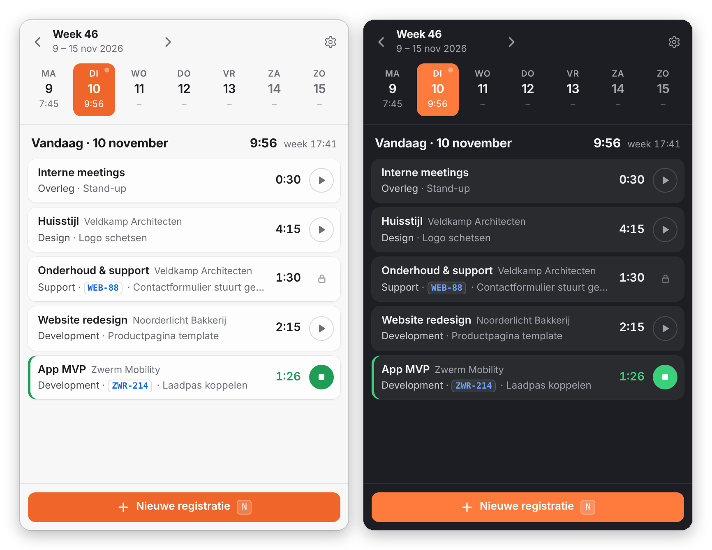
</p>

**[⬇︎ Download de nieuwste versie](https://github.com/jimvaneijk/keito-bar/releases/latest)**
· macOS 12 of nieuwer · Apple Silicon

---

## Installeren

### 1. Downloaden en installeren

1. Download **`Keito-Bar-x.y.z-arm64.dmg`** via de link hierboven (onder *Assets*).
2. Open de DMG en sleep **Keito Bar** naar **Programma's**.
3. Open Keito Bar vanuit Programma's. Er verschijnt een klokje rechtsboven in je menubalk;
   de app heeft geen Dock-icoon.

> **Had je al een oudere versie (van vóór 0.2.0)?** Stop die eerst: klik met rechts op het
> klokje → *Stoppen*. Sleep daarna de nieuwe versie naar Programma's en kies *Vervang*.
> Dit hoeft maar één keer; vanaf nu werkt de app zichzelf automatisch bij.

### 2. Verbinden met Keito

Bij de eerste start opent het venster vanzelf.

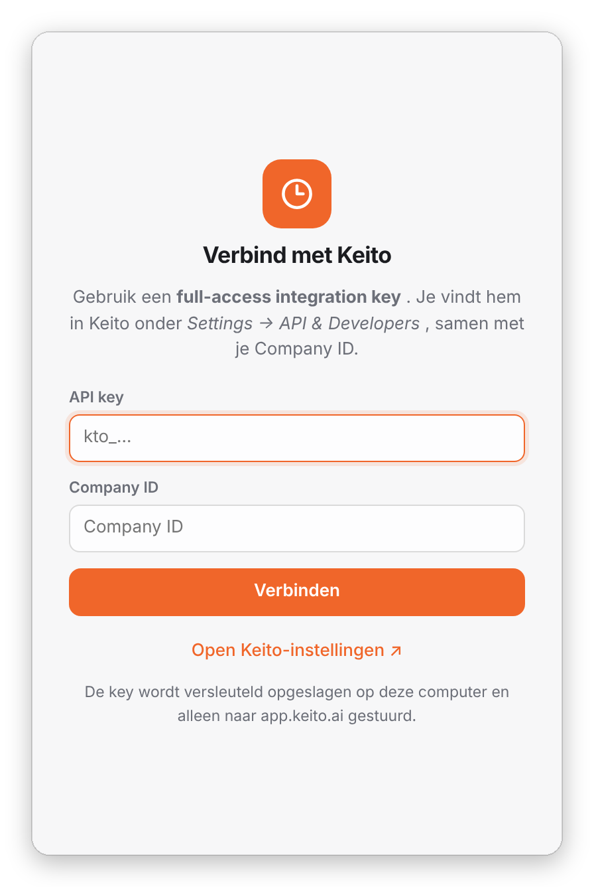

1. Ga in Keito naar **Settings → API & Developers**.
2. Maak een **full-access integration key** aan (begint met `kto_`).
   Een *personal read-only sync key* werkt niet: daarmee kun je geen uren schrijven.
3. Kopieer de key en je **Company ID** naar Keito Bar en klik op **Verbinden**.

De key wordt versleuteld opgeslagen in je macOS-sleutelhanger en alleen naar
`app.keito.ai` gestuurd.

<br clear="right">

### 3. Jira koppelen (optioneel)

Wil je tickets aan je uren koppelen? Ga naar **Instellingen** (tandwiel rechtsboven) → **Jira**:

1. Vul je Jira-adres in, bijvoorbeeld `jouwbedrijf.atlassian.net`.
2. Vul het e-mailadres van je Atlassian-account in.
3. Maak een API-token aan via **API token aanmaken ↗** en plak het erin.

### 4. Laatste puntjes

In **Instellingen** kun je nog:

- **Openen bij inloggen** aanzetten, zodat Keito Bar altijd klaarstaat
- je **accentkleur** kiezen
- je **sneltoets** aanpassen (standaard <kbd>⌘⇧K</kbd>; zie [Sneltoetsen](#sneltoetsen))
- **Notitie of Jira-ticket verplicht** aan- of uitzetten (standaard aan; staat het in Keito zelf
  verplicht, dan geldt het altijd)
- je **werkdagen** en **herinneringstijden** instellen (zie [Herinneringen](#herinneringen))

---

## Gebruiken

Klik op het klokje in de menubalk, of druk overal op **⌘⇧K** (aan te passen in Instellingen).

### Uren schrijven

<table>
  <tr>
    <td width="33%">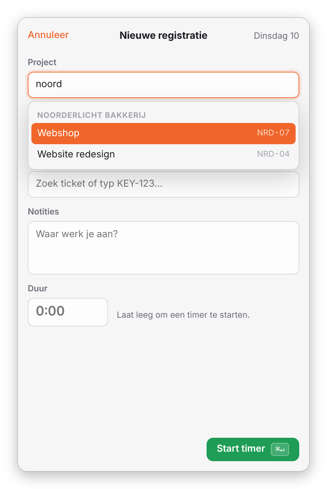</td>
    <td width="33%">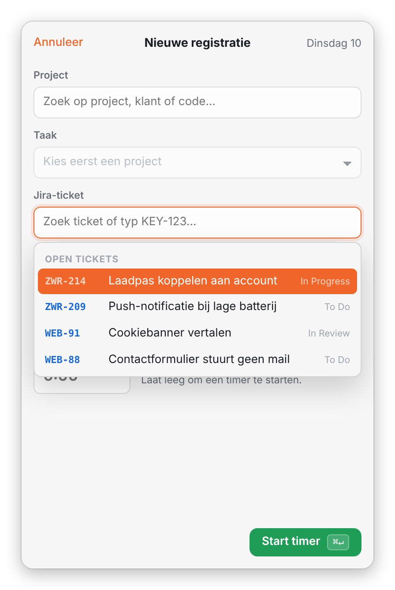</td>
    <td width="33%">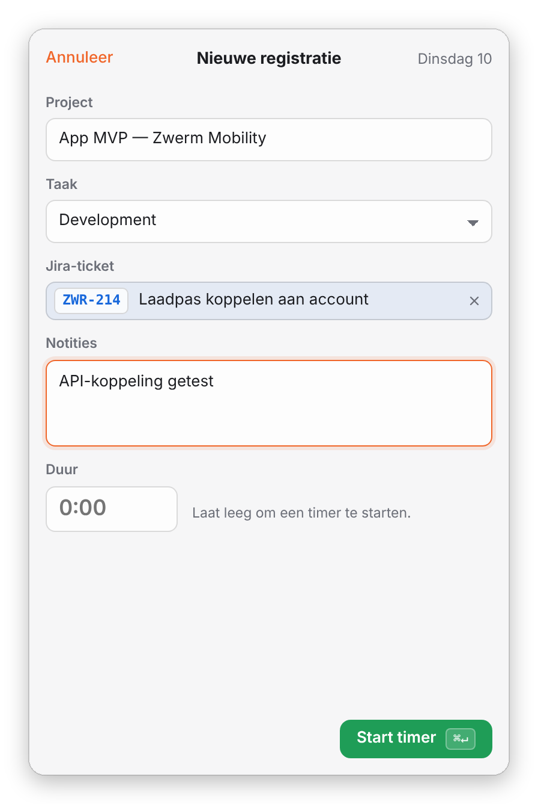</td>
  </tr>
  <tr>
    <td>Zoek op project, klant of code. Alles staat gegroepeerd per klant.</td>
    <td>Kies een Jira-ticket (<kbd>⌘J</kbd>). Leeg zoeken toont je open tickets.</td>
    <td>Duur leeg laten = timer starten. Anders <code>1:30</code>, <code>1,5</code>, <code>90m</code> of <code>1h30</code>.</td>
  </tr>
</table>

- **Timer starten/stoppen**: de knop naast een registratie. Een nieuwe timer stopt de vorige.
- **Lopende timer altijd in zicht**: staat je lopende timer buiten beeld (weggescrold, andere dag
  of week), dan verschijnt hij als groene balk boven *Nieuwe registratie*, met tijd en stopknop.
  Klik erop om ernaartoe te gaan.
- **Andere dag**: klik een dag in de weekstrip, of <kbd>←</kbd> <kbd>→</kbd>. Op andere dagen voeg je uren toe met een duur.
- **Bewerken of verwijderen**: klik op een registratie. Goedgekeurde uren (🔒) zijn alleen-lezen.
- **Taak**: de app onthoudt per project welke taak je het laatst gebruikte.
- **Jira**: de notitie wordt opgeslagen als `KEY-123 · samenvatting — jouw notitie`. Ticketnummers in je lijst zijn klikbaar.

### Losmaken van de menubalk

Liever een gewoon venster naast je werk? Klik rechtsboven op **↗ Losmaken van menubalk**
(of klik met rechts op het klokje → *Losmaken van menubalk*). Het venster:

- blijft open als je ergens anders klikt, en is te verslepen en groter of kleiner te maken
- staat in het Dock en in <kbd>⌘</kbd>-Tab; <kbd>⌘W</kbd> verbergt het, het klokje of <kbd>⌘⇧K</kbd> haalt het terug
- onthoudt waar je het neerzette, ook na een herstart
- kan **altijd bovenop** blijven (rechtsklik op het klokje, of Instellingen)

Met **Terugzetten in menubalk** (dezelfde knop) zit het weer onder het klokje.

### Idle-tijd

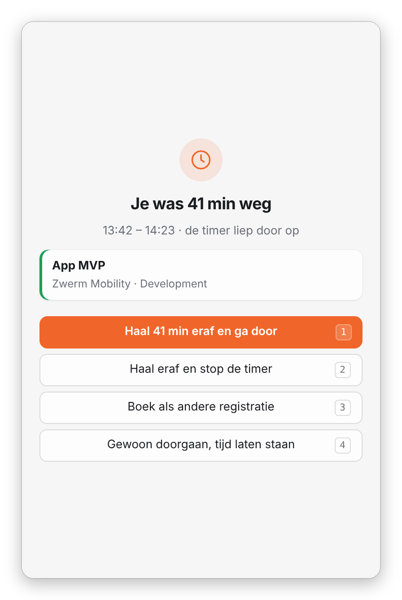

Loopt je timer terwijl je weg bent (geen muis/toetsenbord, scherm op slot of laptop dicht),
dan vraagt Keito Bar bij terugkomst wat je met die tijd wilt:

1. **Haal eraf en ga door**
2. **Haal eraf en stop de timer**
3. **Boek als andere registratie**: het formulier opent met die duur al ingevuld
4. **Gewoon doorgaan**: tijd laten staan

Standaard na 10 minuten; aan te passen in Instellingen (5 min – 1 uur).

<br clear="right">

### Meetings

<table>
  <tr>
    <td width="50%">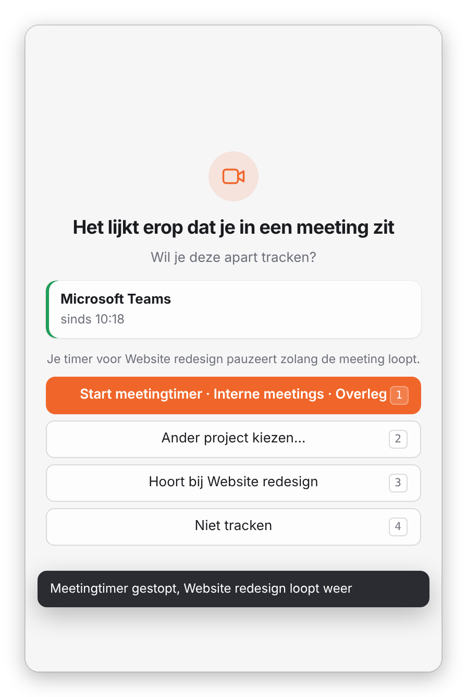</td>
    <td width="50%">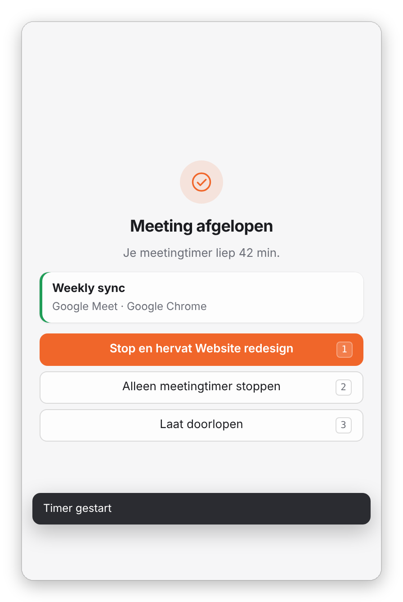</td>
  </tr>
  <tr>
    <td><b>Meeting herkend</b>: na een minuut in gesprek vraagt Keito Bar of je de meeting apart wilt tracken. Je lopende timer pauzeert zolang de meeting loopt.</td>
    <td><b>Meeting afgelopen</b>: stop de meetingtimer en ga met één klik verder met je vorige timer.</td>
  </tr>
</table>

Herkend worden **Google Meet** en **Microsoft Teams** (app én browser), **Zoom**, **Slack-huddles**,
**FaceTime** en **Webex**. Keito Bar kijkt welke app je microfoon gebruikt (niet wát je zegt;
er wordt niets opgenomen). Gebruikt je browser de microfoon, dan zoekt Keito Bar het tabblad
met Google Meet of Teams en neemt de naam van de meeting over.

- **Eerste keer**: kies je project en taak voor meetings; daarna is het één klik
  (*Start meetingtimer · Interne meetings · Overleg*).
- **Browser**: de eerste keer vraagt macOS of Keito Bar je browser mag "besturen". Dat is
  alleen om de tabbladen te lezen; kies **OK**. Zonder toestemming werkt het ook, maar dan
  zonder de naam van de meeting.
- Tijdens een gesprek telt dat niet als idle-tijd.
- Aan/uit en na hoeveel minuten (1–5) staan in **Instellingen → Meetings**. Vereist macOS 14 of nieuwer.

### Budget

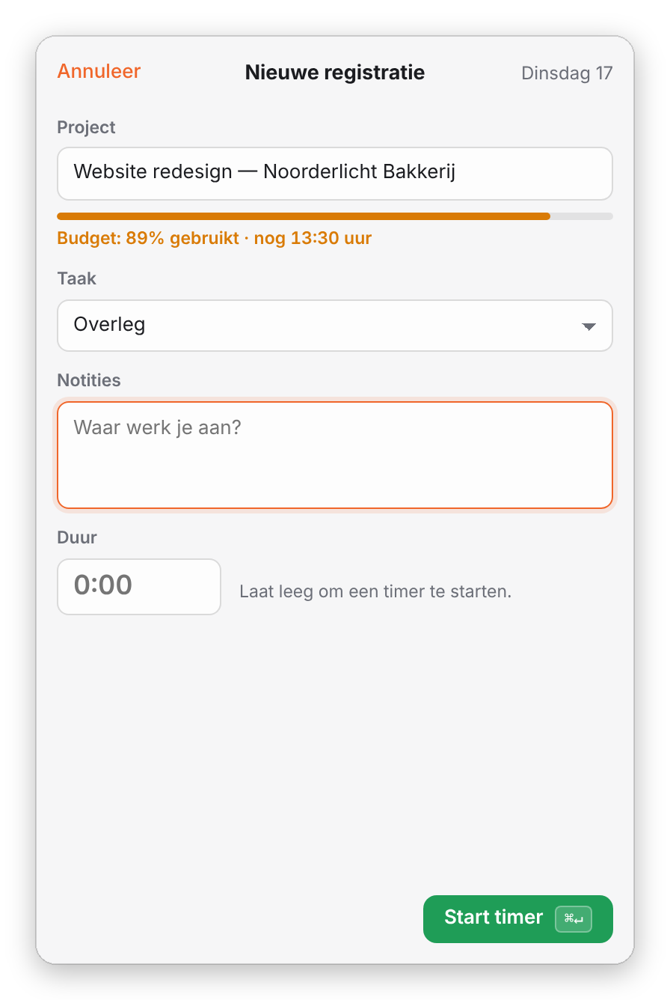

Zit een project bijna of al over zijn budget, dan zie je dat meteen:

- **In het formulier**: een balk onder het project, bijv. *Budget: 89% gebruikt · nog 13:30 uur*
  (oranje vanaf 80%, rood boven 100%). Budgetten per maand staan als *deze maand*.
- **Bij het starten van een timer**: *Let op: Website redesign zit op 89% van het budget*,
  ook als je start vanuit een herinnering of meeting.
- **In je urenlijst**: een klein percentage naast projecten boven de grens.

Je ziet alleen wat je in Keito ook mag zien: **Owners en Administrators** zien alle projecten,
**Managers** (met *View billable rates*) hun eigen projecten. **Medewerkers** zien standaard
niets; een beheerder kan in Keito per project inzage in het geldbudget geven, dan verschijnt
het vanzelf. De grens (70, 80 of 90%) en aan/uit staan in **Instellingen → Budget**.

<br clear="right">

### Herinneringen

<table>
  <tr>
    <td width="33%">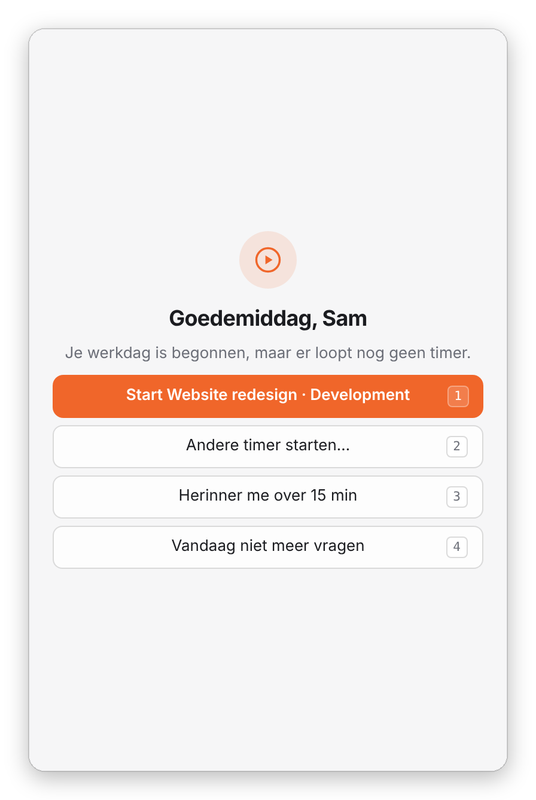</td>
    <td width="33%">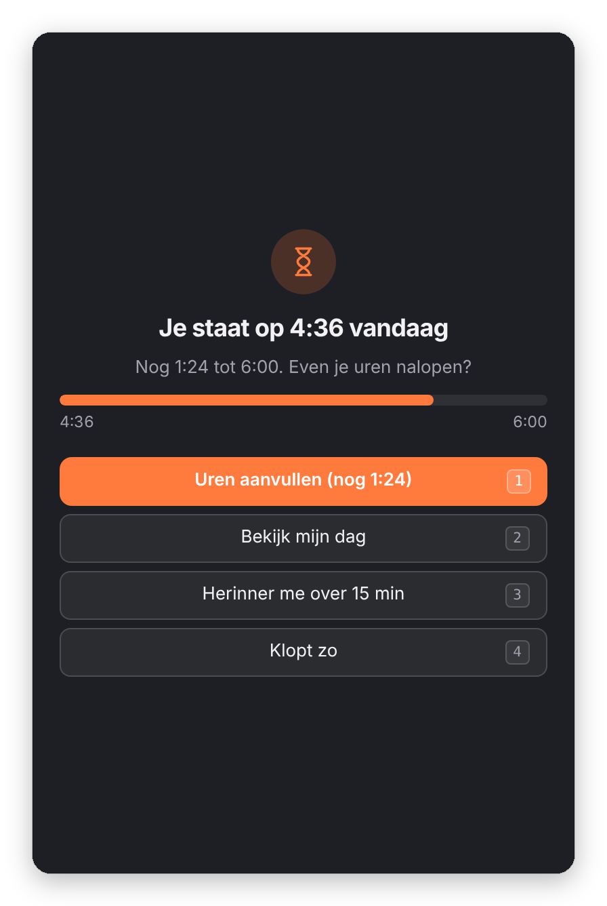</td>
    <td width="33%">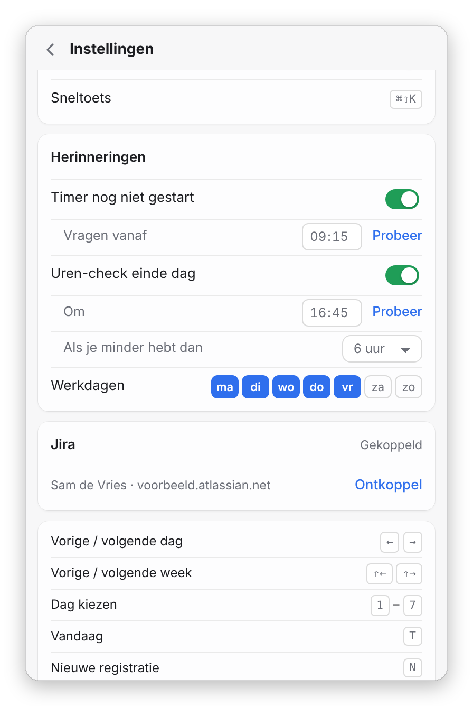</td>
  </tr>
  <tr>
    <td><b>Timer nog niet gestart</b>: vanaf 09:15 zonder lopende timer. Start je laatste project; is een notitie of Jira-ticket verplicht, dan staat het formulier klaar met project en taak al ingevuld.</td>
    <td><b>Uren-check</b>: om 16:45 onder de 6 uur? Dan kun je direct aanvullen; wat ontbreekt staat al ingevuld.</td>
    <td>Tijden, minimum en werkdagen stel je zelf in. Met <b>Probeer</b> zie je de melding direct.</td>
  </tr>
</table>

Herinneringen komen alleen op je werkdagen, als je achter je computer zit, en maximaal één
keer per dag (tenzij je *Herinner me over 15 min* kiest).

### Sneltoetsen

| Toets | Actie |
|---|---|
| <kbd>⌘⇧K</kbd> | Venster openen/sluiten (overal) — zelf in te stellen |
| <kbd>←</kbd> / <kbd>→</kbd> | Vorige / volgende dag |
| <kbd>⇧←</kbd> / <kbd>⇧→</kbd> | Vorige / volgende week |
| <kbd>1</kbd>–<kbd>7</kbd> | Maandag t/m zondag |
| <kbd>T</kbd> | Vandaag |
| <kbd>N</kbd> | Nieuwe registratie |
| <kbd>S</kbd> | Lopende timer stoppen |
| <kbd>⌘J</kbd> | Jira-ticket zoeken (in formulier) |
| <kbd>⌘↵</kbd> | Opslaan |
| <kbd>⌘R</kbd> | Verversen |
| <kbd>Esc</kbd> | Terug / venster sluiten |
| <kbd>⌘W</kbd> | Venster verbergen (ook losgemaakt) |

**Andere sneltoets kiezen.** Gebruikt een andere app <kbd>⌘⇧K</kbd> al (Axure bijvoorbeeld)?
Ga naar **Instellingen → Sneltoets**, klik op de combinatie en druk de toetsen die je wilt.
Je hebt minstens <kbd>⌘</kbd>, <kbd>⌃</kbd> of <kbd>⌥</kbd> nodig. <kbd>⌫</kbd> zet de sneltoets
helemaal uit, <kbd>Esc</kbd> annuleert en **Standaard** zet hem terug op <kbd>⌘⇧K</kbd>. macOS
geeft een combinatie die al bezet is meestal gewoon aan de andere app: doet je nieuwe sneltoets
niets, kies er dan nog een.

---

## Updates

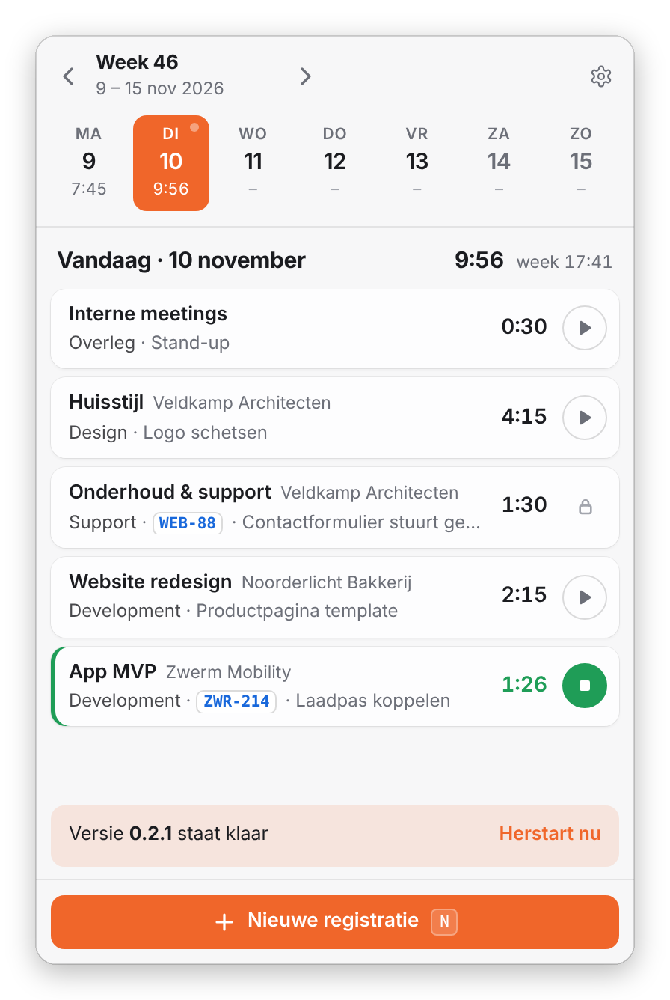

Keito Bar controleert bij het opstarten en elke 4 uur op een nieuwe versie en downloadt die
op de achtergrond. Staat er een klaar, dan zie je **Versie x staat klaar — Herstart nu**.
Klik je niet, dan wordt de update geïnstalleerd zodra je de app afsluit.

Handmatig controleren: **Instellingen → Controleer op updates**.

<br clear="right">

---

## Problemen oplossen

**Ik zie het klokje niet in de menubalk.**
Je menubalk is mogelijk vol (zeker op een MacBook met notch). Sluit wat andere menubalk-apps,
of open Keito Bar met <kbd>⌘⇧K</kbd>. Op macOS 26: controleer bij *Systeeminstellingen →
Menubalk* of Keito Bar is toegestaan.

**⌘⇧K doet niets.**
Een andere app heeft die combinatie waarschijnlijk al (Axure gebruikt hem ook). Kies in
**Instellingen → Sneltoets** een andere combinatie; het klokje blijft gewoon werken.

**Na een update blijft Keito Bar op een draaiend rondje staan.**
macOS vraagt dan eenmalig om toegang tot je sleutelhanger ("Keito Bar wil vertrouwelijke
gegevens gebruiken…"). Die melding staat soms achter andere vensters: zoek hem via Mission
Control, vul je Mac-wachtwoord in en kies **Altijd toestaan**.

**Mijn meeting wordt niet herkend.**
Controleer *Instellingen → Meetings* (vereist macOS 14). Zit je meeting in de browser, kijk
dan bij *Systeeminstellingen → Privacy en beveiliging → Automatisering* of Keito Bar je
browser mag besturen. Firefox kan niet worden uitgelezen; daar krijg je een algemene melding.

**"Keito accepteert de API key of Company ID niet."**
Controleer of je een *full-access integration key* gebruikt (geen sync key) en of de
Company ID bij hetzelfde bedrijf hoort.

**"Keito Bar is beschadigd" of "kan niet worden geopend".**
Dat gebeurt alleen bij versies van vóór 0.2.0. Download de nieuwste DMG via de link bovenaan.

**De timer telt niet goed door.**
Open het venster even: de app haalt dan de laatste stand op uit Keito. Timers die je in de
Keito-webapp start of stopt, verschijnen binnen 2 minuten.

**Ik wil opnieuw beginnen.**
Instellingen → **Ontkoppel API key**. Alle instellingen staan in
`~/Library/Application Support/Keito Bar/`.

---

## Voor ontwikkelaars

### Lokaal draaien

```bash
npm install
npm start
```

Voor ontwikkeling kun je ook `KEITO_API_KEY` en `KEITO_ACCOUNT_ID` als env-variabelen zetten.

### Bouwen en uitrollen

```bash
npm run dist       # lokale testbuild (ad-hoc gesigneerd, niet voor collega's)
npm run release    # gesigneerd + genotariseerd + gepubliceerd op GitHub Releases
```

**Eenmalig instellen**

1. **Developer ID-certificaat**: op developer.apple.com → Certificates → `+` → *Developer ID
   Application* (alleen de Account Holder). Zet het in je **login**-sleutelhanger.
2. **Notarisatie**: maak een app-specifiek wachtwoord op account.apple.com en sla het op:
   ```bash
   xcrun notarytool store-credentials keito-notary \
     --apple-id jouw@appleid.nl --team-id ABCDE12345 --password xxxx-xxxx-xxxx-xxxx
   ```
3. **GitHub**: `brew install gh && gh auth login`. De repo staat in `build.publish` in `package.json`.
4. **Xcode Command Line Tools** (`xcode-select --install`) voor de meetingdetectie. Die wordt
   automatisch gebouwd bij `npm start`, `npm run dist` en `npm run release`; zonder Swift-compiler
   werkt de app gewoon, maar zonder meetingherkenning.

**Nieuwe versie uitbrengen**

```bash
npm version patch --no-git-tag-version   # 0.2.0 → 0.2.1
npm run release                          # of release:universal als er nog Intel-Macs zijn
```

`npm run release` controleert eerst certificaat, notarisatie, GitHub-login, repo-naam en of de
versie nieuw is, en zegt precies wat er ontbreekt. Daarna bouwt, signeert en notariseert het, maakt
één concept-release, uploadt de bestanden één voor één (`latest-mac.yml` als laatste) en publiceert
pas als alles er staat.

Is een upload halverwege afgebroken? Vul de release aan zonder opnieuw te bouwen:

```bash
npm run release -- --upload-only
```

### Structuur

| Pad | Inhoud |
|---|---|
| `main.js` | Menubalk, venster, IPC, opslag van keys, idle-detectie, herinneringen, updates |
| `preload.js` | Veilige brug naar de interface (contextIsolation, sandbox) |
| `src/keito-api.js` | Keito API v2-client (`https://app.keito.ai/api/v2`, Bearer + `Keito-Account-Id`) |
| `src/jira-api.js` | Jira Cloud-client (issue picker + JQL, Basic auth met API-token) |
| `src/meeting-detector.js` | Herkent meetings: welke app gebruikt de microfoon + browsertabbladen |
| `native/mic-monitor.swift` | Klein Swift-programma dat meldt welke apps de microfoon gebruiken (macOS 14+) |
| `renderer/` | Interface (vanilla HTML/CSS/JS) |
| `build/` | Release-script, bouwen van mic-monitor, entitlements en ad-hoc-signering voor testbuilds |
| `docs/screenshots/` | Afbeeldingen voor deze README (gemaakt met voorbeelddata) |

### Codestijl

4 spaties, enkele quotes, regels tot 120 tekens (Prettier, zie `.prettierrc.json`) en
voluit geschreven namen, geen variabelen of functies van één letter.

```bash
npm run format         # alles opmaken
npm run format:check   # alleen controleren
```
